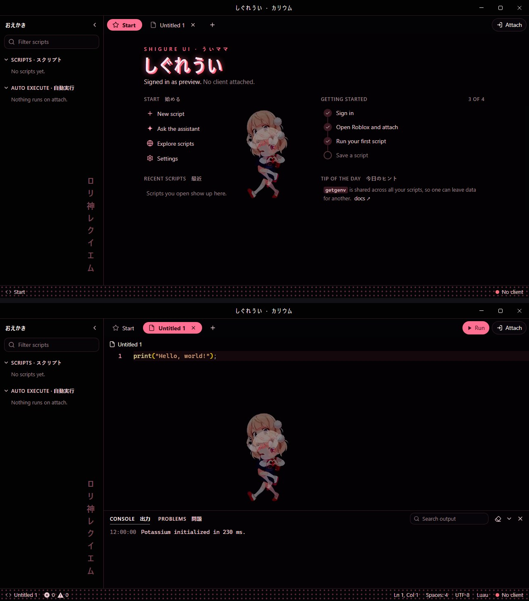
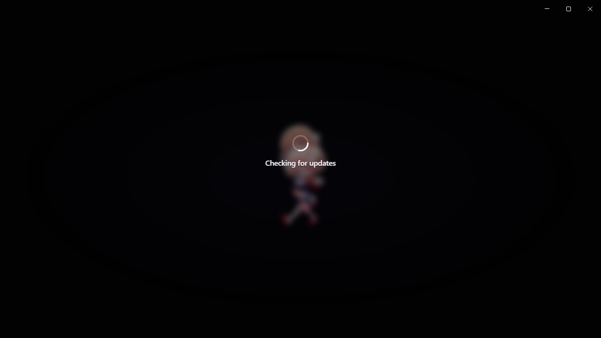

# Shigure Ui theme for Potassium

An animated Shigure Ui theme for the Potassium executor. Midnight black and strawberry pink with pill tabs, a glowing heading and a polka-dot status bar, so the tiny dancer stays the star. A looping wallpaper plays behind the whole app, and the labels are in Japanese.

Previews are animated (AVIF) and show the Start page, a script tab and the loading screen at full size. Browsers that can't play AVIF show a still screenshot instead.

<picture>
  <source srcset="screens.avif" type="image/avif">
  
</picture>

<picture>
  <source srcset="loading.avif" type="image/avif">
  
</picture>

## Install

1. In Potassium, open **Settings → Appearance → Custom theme**.
2. Set **Base theme** to Dark. The editor's syntax colours come from the base theme.
3. Copy everything in [`Theme.css`](Theme.css) and paste it into **Custom CSS**.
4. Type a name under **Save** and click **Save**.

## Loading screen

The theme also replaces Potassium's own loading and login picture with its wallpaper, softly blurred, so the theme starts the moment the app opens (shown above, under the main preview).

## What the Japanese means

| Text | Reading | Meaning |
|---|---|---|
| しぐれうい | Shigure Ui | Her name (title bar and heading) |
| おえかき | oekaki | Doodles (explorer); she's an illustrator |
| ういママ | Ui-mama | Ui-mama, her fans' nickname for her |
| ロリ神レクイエム | Rori-gami Rekuiemu | Loli God Requiem, the song she dances to |

The theme also translates Potassium's own labels:

| Text | Reading | Meaning |
|---|---|---|
| カリウム | karyūmu | Potassium |
| スクリプト | sukuriputo | Scripts |
| 自動実行 | jidō jikkō | Auto execute |
| 出力 | shutsuryoku | Output (console) |
| 問題 | mondai | Problems |
| 始める | hajimeru | Start |
| 最近 | saikin | Recent |
| 今日のヒント | kyō no hinto | Tip of the day |

## Notes

- Wallpapers are animated AVIF files loaded from this repo, so you need internet the first time. If a wallpaper can't load, the colours still apply.
- Potassium cuts custom CSS off at 50,000 characters. This theme is about 6,500, so there's room for your own tweaks.
- The layouts target Potassium's internal class names. A future Potassium update could rename them; if that happens, the colours keep working but some layout touches may not.

## Credits

Shigure Ui and her character art belong to Shigure Ui. The wallpaper is converted from a live wallpaper posted on [WallpaperWaifu](https://wallpaperwaifu.com):
[Shigure Ui Loli Dance](https://wallpaperwaifu.com/anime/shigure-ui-loli-dance-virtual-youtuber-live-wallpaper-2299/).
